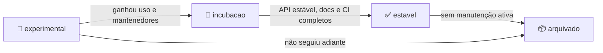

# Softplan

**Há 35 anos transformando o setor público brasileiro com tecnologia.**

Justiça · Processos Digitais e Administrativos · Infraestrutura e Obras

---

## 👋 Quem somos

A Softplan nasceu em **1990, em Florianópolis**, e hoje é uma das maiores empresas de tecnologia para o **setor público** do Brasil. Nossas soluções apoiam tribunais, Ministérios Públicos, procuradorias, prefeituras e órgãos de infraestrutura, e são parte da história da transformação digital da Justiça brasileira.

Trabalhamos em três frentes:

| | Segmento | O que fazemos |
|---|---|---|
| ⚖️ | **Justiça** | Plataformas que digitalizam e automatizam o trabalho de tribunais, Ministérios Públicos e procuradorias, com IA aplicada ao dia a dia jurídico. |
| 📄 | **Processos Digitais e Administrativos** | Soluções que tiram o papel da gestão pública e tornam os processos mais rápidos e transparentes. |
| 🏗️ | **Infraestrutura e Obras** | Gestão de obras e contratos públicos, do planejamento à medição. |

> **Nossa crença:** quando o Estado funciona melhor, a vida do cidadão melhora. Cada linha de código aqui tem esse destino final.

---

## 🌐 Open source na Softplan

Este perfil é a porta de entrada para tudo o que publicamos abertamente. Usamos muito software livre e queremos devolver parte desse valor para a comunidade: bibliotecas, ferramentas de engenharia, pesquisa e experimentos.

### Nossos princípios

1. **Aberto com responsabilidade.** Publicamos o que gera valor para a comunidade. **Nunca** publicamos dados de clientes, dados processuais, credenciais ou qualquer informação sigilosa.
2. **Mantenedores com nome e sobrenome.** Todo repositório público tem responsáveis definidos no `CODEOWNERS`. Projeto sem dono é arquivado.
3. **Transparência de maturidade.** Você sempre sabe em que estágio um projeto está antes de depender dele (veja abaixo).
4. **Mesma régua de qualidade.** Código aberto passa pelos mesmos padrões de revisão, testes e segurança dos nossos produtos.
5. **Comunidade antes de vitrine.** Preferimos poucos projetos bem cuidados a muitos repositórios abandonados.

### 🧭 Ciclo de vida dos projetos

Cada repositório público carrega um *topic* do GitHub indicando seu estágio:

| Estágio | Topic | O que esperar |
|---|---|---|
| 🧪 **Experimental** | `maturidade-experimental` | Provas de conceito, pesquisas e protótipos. Pode mudar ou sumir sem aviso. |
| 🌱 **Incubação** | `maturidade-incubacao` | Em uso real, evoluindo rápido. A API ainda pode quebrar entre versões. |
| ✅ **Estável** | `maturidade-estavel` | Versionamento semântico, changelog, CI e mantenedores ativos. Pode depender. |
| 📦 **Arquivado** | `maturidade-arquivado` | Somente leitura. Fica disponível para consulta e *fork*. |

> 💡 Dica: filtre os repositórios desta organização pelo *topic* para encontrar só o que já está pronto para produção.

---

## 🤝 Como contribuir

Contribuições são muito bem-vindas, sejam de pessoas da comunidade ou de *Softplayers*.

### O caminho de uma contribuição

1. **Comece por uma issue.** Antes de abrir um PR grande, descreva o problema ou a ideia. Issues marcadas com `good first issue` são ótimas para começar.
2. **Faça um fork** e crie uma branch descritiva (`feat/exportacao-csv`, `fix/timeout-integracao`).
3. **Siga as convenções do repositório.** Usamos [Conventional Commits](https://www.conventionalcommits.org/pt-br/) e cada projeto descreve seus detalhes no próprio `CONTRIBUTING.md`.
4. **Inclua testes e documentação.** PR que muda comportamento precisa mostrar como foi validado.
5. **Abra o Pull Request** usando o template. O CI precisa passar e ao menos um mantenedor (`CODEOWNERS`) vai revisar.
6. **Converse.** Revisão de código aqui é diálogo, não veredito. Pode discordar, com argumentos.

### Uso de IA nas contribuições

Contribuições feitas com apoio de assistentes de IA são bem-vindas. A regra é simples: **você é o autor**. Entenda, teste e responda por cada linha que enviar.

### Arquivos de comunidade

Os arquivos padrão deste repositório `.github` valem para todos os projetos da organização que não tiverem os seus próprios:

- 📜 `CODE_OF_CONDUCT.md`: como esperamos que todos se tratem
- 🛠️ `CONTRIBUTING.md`: o guia geral de contribuição
- 🔐 `SECURITY.md`: como reportar vulnerabilidades
- 🧩 Templates de issue e Pull Request

---

## 🔐 Segurança

Encontrou uma vulnerabilidade? **Não abra uma issue pública.** Use o recurso *Report a vulnerability* (aba **Security** do repositório afetado) para nos enviar o relato de forma privada. Respondemos, corrigimos e damos o devido crédito a quem reportou.

---

## 🚀 Para Softplayers: abrindo um projeto

Quer tornar público algo que o seu time construiu? Antes de mudar a visibilidade do repositório, confira:

- [ ] O projeto não contém dados de clientes, segredos ou código proprietário de produto
- [ ] *Secret scanning* executado em **todo o histórico** do Git, não só no último commit
- [ ] `README.md`, `LICENSE` e `CODEOWNERS` presentes
- [ ] Ao menos dois mantenedores definidos
- [ ] *Topic* de maturidade aplicado
- [ ] Aprovação das áreas de Arquitetura, Segurança e Jurídico

---

## 📜 Licenças

Cada repositório declara sua licença no arquivo `LICENSE`. Na ausência dele, o código **não** está licenciado para reuso.

---

**Softplan** · Florianópolis, SC · [softplan.com.br](https://www.softplan.com.br)

Feito com ☕ e muito código por *Softplayers*.

